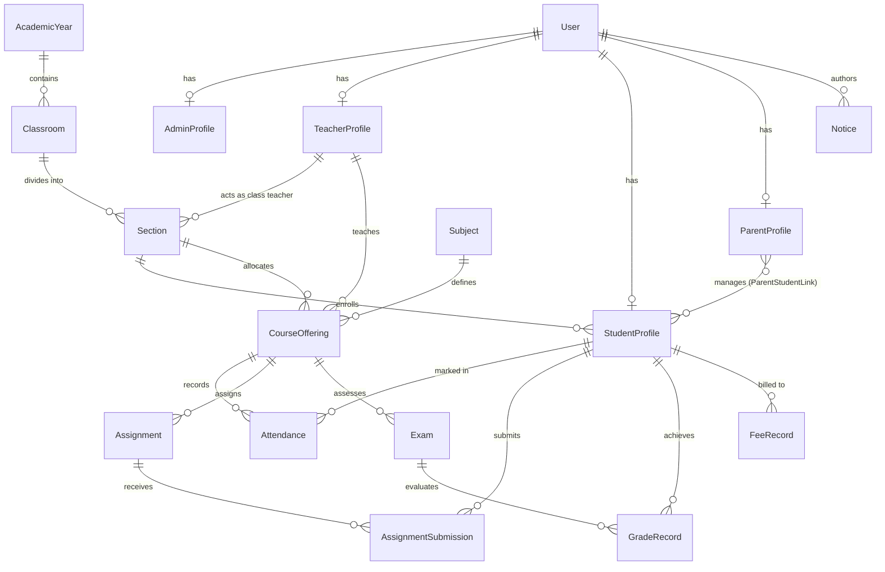
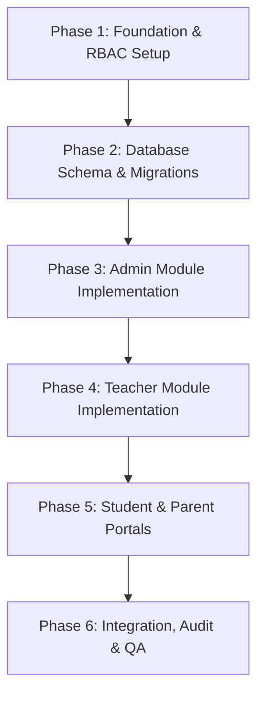

# School Management System - Implementation Plan

## 1. Project Overview

The **School Management System (SMS)** is an educational platform designed to streamline administrative workflows, simplify academic operations, and bridge communication across all primary school stakeholders.

The system is architected around exactly four core user roles:
- **Admin**: Oversees institutional configurations, user lifecycle management, academic setup, and overall system governance.
- **Teacher**: Manages daily classroom operations, student attendance, assignments, and academic evaluation.
- **Student**: Accesses learning schedules, tracks academic progress, submits assignments, and monitors attendance.
- **Parent**: Monitors the academic trajectory, attendance records, fee status, and school notices for their enrolled child(ren).

### Architectural Goals
- **Modularity**: Clean separation of responsibilities aligned with the four functional modules.
- **Security & Data Isolation**: Strict Role-Based Access Control (RBAC) ensuring users only access authorized records.
- **Scalability**: Normalized relational database schema capable of handling multi-section classes, grade books, and historical logs.
- **Maintainability**: Follows standard Django/Python backend best practices (clean models, views/services, and granular permissions).

---

## 2. Admin Module Plan

### Purpose
The Admin Module serves as the centralized governance cockpit of the school management ecosystem. It provides system administrators with tools to configure the institutional structure, manage user accounts, assign roles, define academic calendars, and maintain audit logs.

### Dashboard Features
- **Key Metrics Overview**: Total counts of active students, teachers, parents, and classes.
- **Attendance Summary**: Real-time school-wide attendance statistics and trends.
- **Recent Activity Feed**: Audit trail of recent logins, profile creations, and major updates.
- **System Health & Alerts**: Notifications regarding unassigned classrooms, pending fee reconciliations, and academic term transitions.
- **Quick Action Bar**: Shortcuts for onboarding users, creating classrooms, and publishing school-wide announcements.

### Permissions
- Full CRUD access to all database entities and user accounts.
- Authority to assign, revoke, and manage user roles (Admin, Teacher, Student, Parent).
- Exclusive permissions to modify school settings, academic sessions, terms, and grading scales.
- Access to raw audit logs, user activity logs, and system error logs.

### Main Functionalities
1. **User Lifecycle Management**:
   - Create, update, deactivate, and archive accounts for Teachers, Students, and Parents.
   - Batch import/export of student and teacher profiles.
   - Secure credential generation and password reset management.
2. **Academic Structure Setup**:
   - Manage Academic Years, Semesters/Terms, Classes/Grades, Sections, and Subjects.
   - Assign class teachers to sections and assign subject teachers to specific classes.
3. **Parent-Student Linking**:
   - Map one or more students to verified parent/guardian accounts.
4. **Institutional Announcements**:
   - Draft, schedule, and broadcast institutional announcements targeted globally or role-specifically.
5. **Fee & Financial Structure Configuration**:
   - Define fee heads, payment schedules, and discount/scholarship criteria per grade level.
6. **Reporting & System Auditing**:
   - Generate macro-level institutional reports (enrollment figures, attendance averages, academic distributions).

---

## 3. Teacher Module Plan

### Purpose
The Teacher Module empowers educators to handle day-to-day academic instructions, student evaluations, and classroom management efficiently, minimizing administrative overhead so teachers can focus on pedagogy.

### Dashboard Features
- **Today's Class Schedule**: Interactive timetable displaying allocated classes, subjects, and periods for the day.
- **Quick Attendance Widget**: One-click launcher to take or edit attendance for current periods.
- **Pending Tasks**: Counter for ungraded assignment submissions and pending evaluation deadlines.
- **Class Performance Snapshot**: Summary charts showing recent assessment averages for assigned sections.
- **Notice Board**: Displays institutional announcements relevant to teaching staff.

### Permissions
- Read access to roster and profile details of students enrolled in assigned classes/subjects.
- Full CRUD access to attendance registers for assigned classes and periods.
- Create, update, and evaluate assignments, quizzes, and exams for their designated subjects.
- Enter, modify (within grading windows), and finalize marks and qualitative feedback.
- Read-only access to relevant parent contact information for their enrolled students.

### Main Functionalities
1. **Attendance Management**:
   - Mark daily or period-level attendance (Present, Absent, Late, Excused).
   - View monthly/term attendance trends and flag chronically absent students.
2. **Curriculum & Assignment Management**:
   - Create assignments with deadlines, instructions, and file attachments.
   - Review student submissions, assign marks/grades, and provide constructive commentary.
3. **Gradebook & Assessment Entry**:
   - Record formative assessments, midterms, and final exam marks against the configured grading schema.
   - Calculate grade point averages and generate provisional report cards.
4. **Timetable & Schedule Viewer**:
   - View individual weekly teaching schedule and examination duty rosters.
5. **Student Progress Monitoring**:
   - Track individual student academic trends and log observational notes for parent meetings.

---

## 4. Student Module Plan

### Purpose
The Student Module provides a personalized, transparent interface for learners to organize their academic schedule, access evaluation outcomes, complete assignments, and stay informed on institutional deadlines.

### Dashboard Features
- **Daily Timetable**: Highlighting the current period, upcoming classes, and assigned teachers.
- **Upcoming Deadlines**: Prioritized list of pending homework, project submissions, and upcoming examinations.
- **Attendance Metric Card**: Personal overall attendance percentage with visual threshold warnings (e.g., minimum 75% required).
- **Recent Grades / Results**: Display of recently published assessment outcomes with teacher feedback.
- **School Notice Carousel**: Highlighting relevant student circulars, holiday notices, and events.

### Permissions
- Strictly read-only access to own profile, class timetable, and institutional announcements.
- Read-only access to personal attendance records and published examination results.
- Create and update permissions limited to submitting personal assignments prior to submission deadlines.
- Prohibited from viewing or accessing other students' grades, profiles, or disciplinary records.

### Main Functionalities
1. **Academic Timetable & Schedule**:
   - View weekly class timetable, subject breakdown, and examination timetables.
2. **Assignment Tracking & Submission**:
   - View assigned tasks, download study resources/rubrics, and upload digital submissions.
   - Track submission status (Pending, Submitted, Graded, Overdue).
3. **Attendance History**:
   - Detailed calendar view of daily attendance with category breakdown.
4. **Academic Performance & Report Cards**:
   - View subject-wise performance, historical term marks, and download verified digital report cards.
5. **Notice & Circular Hub**:
   - View categorized school announcements and student-specific notices.

---

## 5. Parent Module Plan

### Purpose
The Parent Module delivers real-time visibility into the child's academic journey, behavioral attendance, institutional notices, and financial fee records, fostering a collaborative school-parent relationship.

### Dashboard Features
- **Child Selector Switcher**: Seamless switching between multiple enrolled siblings/wards from a single login.
- **Child Overview Card**: Snapshot of selected child's current attendance rate, recent grades, and conduct remarks.
- **Fee Due Alert**: Highlight of impending fee deadlines, past due reminders, and quick payment receipts.
- **Upcoming Events & Exams**: Calendar view of parent-teacher conferences, upcoming exams, and holidays.
- **Direct School Notices**: Circulars, holiday declarations, and emergency alerts.

### Permissions
- Read-only access restricted strictly to the records of linked biological or legal wards (attendance, grades, timetable, fees).
- Read access to school notices and communications directed to parents.
- Read and download access to fee receipts and invoices.
- Strict isolation preventing access to any student record outside their designated children.

### Main Functionalities
1. **Multi-Ward Management**:
   - Single portal to monitor academic status of multiple children across different grades/sections.
2. **Attendance Monitoring**:
   - Real-time notification and calendar visualization of child's daily presence, absence, and late marks.
3. **Academic Progress Tracking**:
   - Inspect continuous assessment results, term report cards, and teacher remarks.
4. **Fee Status & Receipts**:
   - View itemized fee breakdowns (tuition, laboratory, library), outstanding balances, payment due dates, and historic receipts.
5. **Teacher Communication & Meeting Logs**:
   - View designated teacher office hours and log requests for Parent-Teacher Meetings (PTM).
6. **School Circulars**:
   - Access verified institutional notices, emergency advisories, and term schedules.

---

## 6. Role-Based Access Control (RBAC) Plan

### 6.1 Role Hierarchy & Permissions Matrix

| Feature / Resource | Admin | Teacher | Student | Parent |
| :--- | :---: | :---: | :---: | :---: |
| User Account Management (CRUD) | Full | None | None | None |
| Class & Subject Allocation | Full | Read Only | None | None |
| Take / Edit Student Attendance | Full | Own Classes | None | None |
| View Attendance Records | Full | Own Classes | Own Record | Ward(s) Record |
| Create / Grade Assignments | Full | Own Classes | Submit Only | Read Only |
| Input Exam Marks / Grades | Full | Own Classes | None | None |
| View Final Report Cards | Full | Own Classes | Own Record | Ward(s) Record |
| Configure Fee Structure & Rates | Full | None | None | None |
| View Fee Status & Invoices | Full | None | None | Ward(s) Record |
| Post Institutional Notices | Full | None | None | None |
| View School Notices | Full | All Relevant | All Relevant | All Relevant |

### 6.2 Authentication & Authorization Architecture
1. **Authentication Layer**:
   - Unified `User` model using email/username and salted password hashing (Argon2 / PBKDF2).
   - Session-based authentication for server-rendered views or JWT (JSON Web Tokens) for decoupled REST APIs.
2. **Role Association**:
   - Each user account is explicitly linked to an enumeration role: `ADMIN`, `TEACHER`, `STUDENT`, `PARENT`.
   - Each role is paired with a distinct 1-to-1 profile model storing role-specific domain attributes.
3. **Authorization Strategy**:
   - **View / Endpoint Level Guard**: Middleware/decorators restricting entry points based on authenticated user's role (e.g., `@role_required(['ADMIN'])`, `@role_required(['TEACHER'])`).
   - **Object-Level Permissions**:
     - *Teachers*: Can only access queries where `Classroom.teacher == request.user.teacher_profile` or `SubjectTeacherAllocation.teacher == request.user.teacher_profile`.
     - *Students*: Can only retrieve objects where `student_id == request.user.student_profile.id`.
     - *Parents*: Can only retrieve objects where `student_id IN request.user.parent_profile.wards.values_list('id')`.
4. **Security Hardening**:
   - Prevention of horizontal privilege escalation (e.g., Student A cannot access Student B's grades by tampering with primary keys).
   - Prevention of vertical privilege escalation (e.g., Teachers or Students cannot hit administrative routes).

---

## 7. Basic Database Entities Required

### 7.1 Entity Specifications

1. **`User`**
   - `id` (PK, UUID or BigInt)
   - `username`, `email`, `password_hash`
   - `role` (Enum: `ADMIN`, `TEACHER`, `STUDENT`, `PARENT`)
   - `is_active`, `date_joined`, `last_login`

2. **`AdminProfile`**
   - `id` (PK)
   - `user_id` (OneToOne -> `User`)
   - `department`, `office_extension`

3. **`TeacherProfile`**
   - `id` (PK)
   - `user_id` (OneToOne -> `User`)
   - `employee_id` (Unique string)
   - `qualification`, `joining_date`, `specialization`

4. **`StudentProfile`**
   - `id` (PK)
   - `user_id` (OneToOne -> `User`)
   - `admission_number` (Unique string)
   - `roll_number`
   - `section_id` (FK -> `Section`)
   - `dob`, `blood_group`, `emergency_contact`

5. **`ParentProfile`**
   - `id` (PK)
   - `user_id` (OneToOne -> `User`)
   - `relationship_type` (Father, Mother, Guardian)
   - `phone_number`, `alternate_phone`, `residential_address`

6. **`ParentStudentLink`**
   - `id` (PK)
   - `parent_id` (FK -> `ParentProfile`)
   - `student_id` (FK -> `StudentProfile`)
   - `is_primary_contact` (Boolean)

7. **`AcademicYear` & `Classroom` & `Section`**
   - `AcademicYear`: `name` (e.g., 2026-2027), `start_date`, `end_date`, `is_active`
   - `Classroom`: `name` (e.g., Grade 10)
   - `Section`: `name` (e.g., Section A), `classroom_id` (FK), `class_teacher_id` (FK -> `TeacherProfile`)

8. **`Subject` & `CourseOffering`**
   - `Subject`: `name`, `code` (e.g., MATH101)
   - `CourseOffering`: `section_id` (FK), `subject_id` (FK), `teacher_id` (FK -> `TeacherProfile`)

9. **`Attendance`**
   - `id` (PK)
   - `course_offering_id` (FK -> `CourseOffering` or `Section`)
   - `student_id` (FK -> `StudentProfile`)
   - `date` (Date)
   - `status` (Enum: `PRESENT`, `ABSENT`, `LATE`, `EXCUSED`)
   - `remarks` (Text, optional)

10. **`Assignment` & `AssignmentSubmission`**
    - `Assignment`: `course_offering_id` (FK), `title`, `description`, `due_date`, `max_marks`, `attachment_url`
    - `AssignmentSubmission`: `assignment_id` (FK), `student_id` (FK), `submission_text`, `attachment_url`, `submitted_at`, `marks_obtained`, `feedback`

11. **`Exam` & `GradeRecord`**
    - `Exam`: `name` (Midterm, Final), `course_offering_id` (FK), `exam_date`, `max_marks`
    - `GradeRecord`: `exam_id` (FK), `student_id` (FK), `marks_obtained`, `grade_point`, `remarks`

12. **`FeeRecord`**
    - `id` (PK)
    - `student_id` (FK -> `StudentProfile`)
    - `title` (e.g., Term 1 Tuition Fee)
    - `amount_due`, `amount_paid`, `due_date`, `status` (Enum: `UNPAID`, `PARTIAL`, `PAID`)

13. **`Notice`**
    - `id` (PK)
    - `title`, `content`, `created_by` (FK -> `User`)
    - `target_role` (Enum: `ALL`, `TEACHER`, `STUDENT`, `PARENT`)
    - `created_at`

---

## 8. Implementation Phases

### Phase 1: Foundation & RBAC Setup
- Establish custom User authentication model extending AbstractBaseUser.
- Configure role enumerations (`ADMIN`, `TEACHER`, `STUDENT`, `PARENT`).
- Implement core authentication middlewares, security mixins, and role validation decorators.
- Setup base layouts and styling templates for role-oriented dashboards.

### Phase 2: Database Schema & Migrations
- Implement profile models (`AdminProfile`, `TeacherProfile`, `StudentProfile`, `ParentProfile`).
- Build academic structures (`AcademicYear`, `Classroom`, `Section`, `Subject`, `CourseOffering`).
- Construct transactional and academic models (`Attendance`, `Assignment`, `Exam`, `GradeRecord`, `FeeRecord`, `Notice`).
- Execute database migrations, establish foreign key constraints, unique checks, and index optimizations.

### Phase 3: Admin Module Implementation
- Implement administrative dashboard with school-wide analytics and summaries.
- Build CRUD interfaces for Teachers, Students, Parents, and Class allocations.
- Implement Parent-Student linkage workflows.
- Configure institutional notices and fee schedules.

### Phase 4: Teacher Module Implementation
- Build teacher dashboard with daily timetable feeds.
- Develop attendance entry interface with bulk selection and fast-save capabilities.
- Create assignment authoring, deadline scheduling, and submission grading interfaces.
- Implement exam marks entry views and grade calculation utilities.

### Phase 5: Student & Parent Portals
- Build Student dashboard: timetable viewer, assignment submission pipeline, and personal report card downloads.
- Build Parent portal: multi-ward switching mechanism, attendance calendars, fee due viewer, and progress tracking.
- Restrict all views with strict object-level permission boundaries.

### Phase 6: Integration, Audit & QA
- Implement comprehensive unit and integration test suites.
- Perform horizontal and vertical access vulnerability testing.
- Conduct cross-browser UI/UX testing and load testing on grade and attendance query paths.
- Prepare deployment checklists and documentation.

---

## 9. Testing Checklist

### 9.1 Authentication & RBAC Verification
- [ ] User can log in with valid credentials and receives the appropriate role context.
- [ ] Inactive or suspended accounts are barred from authentication.
- [ ] Admin can access `/admin/` and administrative control panels.
- [ ] Teacher cannot access administrative configuration URLs (returns 403 Forbidden).
- [ ] Student cannot access Teacher or Admin routes (returns 403 Forbidden).
- [ ] Parent cannot access Teacher or Admin routes (returns 403 Forbidden).

### 9.2 Object-Level Data Isolation (Anti-Tampering)
- [ ] Teacher can only view and edit attendance/grades for classes they are assigned to teach.
- [ ] Student can only view their own grades, attendance, and assignment submissions.
- [ ] Student cannot view or modify another student's assignment submission via ID tampering.
- [ ] Parent can only view records of their explicitly mapped children.
- [ ] Parent cannot access records of unlinked students by manipulating query parameters or URL path parameters.

### 9.3 Admin Module Functional Tests
- [ ] Creating an Admin, Teacher, Student, or Parent user correctly establishes the User record and its corresponding Profile model.
- [ ] Academic Year, Class, Section, and Subject hierarchies enforce referential integrity.
- [ ] Linking a parent to multiple students enables multi-ward switcher in Parent portal.
- [ ] Publishing an announcement with a target role ensures it displays only in that role's feed.

### 9.4 Teacher Module Functional Tests
- [ ] Daily timetable accurately reflects scheduled periods and assigned classrooms.
- [ ] Marking attendance correctly creates or updates `Attendance` records without duplicate entries per student/day.
- [ ] Creating an assignment correctly makes it visible to all students in that specific section.
- [ ] Scoring student assignment submissions properly calculates total marks and persists feedback.
- [ ] Exam marks entry prevents values outside the configured range (e.g., negative scores or scores exceeding `max_marks`).

### 9.5 Student Module Functional Tests
- [ ] Student can view weekly timetable accurately.
- [ ] Student can successfully upload assignment submissions before the due date.
- [ ] Student is blocked from uploading submissions past the cutoff timestamp if late submissions are disabled.
- [ ] Attendance summary accurately computes percentage `(present_days / total_school_days) * 100`.
- [ ] Report cards accurately display published marks and grades.

### 9.6 Parent Module Functional Tests
- [ ] Sibling selector properly switches active student context without cross-contaminating session state.
- [ ] Child attendance reflects real-time updates submitted by teachers.
- [ ] Child fee ledger accurately calculates outstanding balances against recorded payments.
- [ ] Emergency announcements and school circulars are prominently visible.

